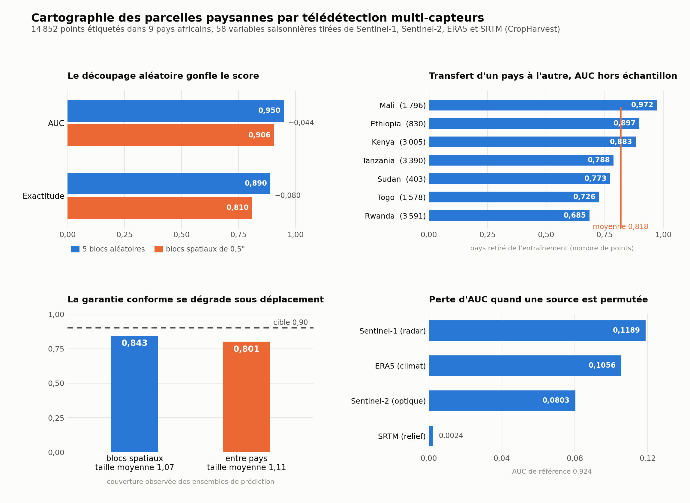

# Applied Econometrics, Geospatial Data and Machine Learning

[](https://github.com/tchiofoubruel-prog/applied-econometrics-and-ml/actions/workflows/tests.yml)
[](https://github.com/tchiofoubruel-prog/applied-econometrics-and-ml/actions/workflows/notebook-check.yml)
[](https://github.com/tchiofoubruel-prog/applied-econometrics-and-ml/actions/workflows/render-check.yml)
[](LICENSE)

Analysis code written between 2023 and 2026, in Python, Stata and R Markdown, with smaller SAS and
SQL projects. The Python side
builds gridded climate data into analysis panels with xarray, rioxarray, rasterstats, geopandas,
shapely and fiona, geocodes survey locations with geopy and OSMnx, and models the result with
NumPy, pandas, scikit-learn, statsmodels, XGBoost and SHAP. The Stata and R Markdown sides cover
impact evaluation, panel econometrics and household survey measurement, on data from Rwanda, Mali,
Albania and the World Bank indicators, together with survey sampling and mixed models in R, a data
preparation pipeline in SAS and sales analysis in T-SQL. The most recent addition reads satellite imagery:
[`python-projects/eo-resilience/`](python-projects/eo-resilience/) combines Sentinel-1 radar,
Sentinel-2 optical, ERA5 reanalysis and SRTM terrain over smallholder plots, and is the one part of
the repository whose tests are executed rather than only parsed.

**Start here:** [`method-demos/`](method-demos/) holds the two notebooks that run from this
repository alone, a Monte Carlo cost-benefit analysis with Sobol sensitivity indices and an
interpretable machine-learning pipeline with its validation design written out in the notebook.
Both generate their own synthetic inputs, which is why their outputs are kept and why the pair of
figures they produce, shown below the satellite results, can be reproduced without any external
file. The project of longest reach is
[`python-projects/data-science/`](python-projects/data-science/), a 1901 to 2023 climate and mining
panel assembled from CRU TS4.08 NetCDF grids, and the single largest body of code is
[`python-projects/geocoding-cities/`](python-projects/geocoding-cities/), about 4,300 lines that
resolve and validate city coordinates.

<p align="center">
  
</p>

<p align="center"><sub>Crop mapping from Sentinel-1, Sentinel-2, ERA5 and SRTM on 14,852 labelled
points in nine African countries. Random splitting overstates the AUC by 0.044 against spatial
blocks, transfer between countries ranges from 0.972 to 0.685, conformal sets built for 90 per cent
coverage reach 84.3 per cent under spatial blocks and 80.1 per cent across borders, and the radar
bands carry more signal than the optical ones. Produced by
<code>python-projects/eo-resilience/scripts/04_africa_benchmark.py</code>.</sub></p>

<p align="center">
  
  
</p>

<p align="center"><sub>Left, the SHAP summary from the machine-learning notebook. Right, first-order
and total Sobol indices from the Monte Carlo notebook. Both are computed on synthetic inputs.</sub></p>

## Running the method demos

```bash
git clone https://github.com/tchiofoubruel-prog/applied-econometrics-and-ml.git
cd applied-econometrics-and-ml
pip install -r requirements.txt
jupyter lab method-demos/
```

Running the two notebooks end to end reproduces the four figures in `method-demos/figures/`. Every
other folder reads its inputs from a local `./data` path that you supply, described in that folder's
own README.

## Code organisation and checks

The repository is organised as Jupyter notebooks, Stata do-files, R Markdown reports and SAS and
SQL scripts, one folder per project, each
with its own README covering the data and the method. Three GitHub Actions workflows run on every
push: the Python notebooks are converted with nbconvert and byte-compiled, the R Markdown files are
purled with knitr and parsed, and the 95 unit tests of the `eo-resilience` package are executed.
The first two confirm that the code parses and compiles and stop short of running it, since the
source data stays outside the repository. The third runs for real, because that package builds its
own rasters in a temporary directory and needs nothing from outside. Of the
sixteen notebooks, the two in `method-demos/` keep their executed outputs, and the other fourteen
have their outputs cleared. The SAS and SQL scripts are not checked automatically.

Code volume, counted in code cells and script lines rather than in repository bytes: about 9,600
lines of Python, 4,700 of Stata, 3,900 of R Markdown, 600 of SAS and 200 of SQL. GitHub's language bar reports notebooks
under "Jupyter Notebook" and classifies R Markdown as prose, so neither Python nor R appears in it.

## Standalone repositories

Each project below also has its own repository, so that it can be pinned, starred or cloned on its
own. The copies hold the same files as the folder here, plus a licence. This repository remains the
reference copy and the one the checks run on.

| Repository | Folder here |
|---|---|
| [`eo-resilience`](https://github.com/tchiofoubruel-prog/eo-resilience) | [`python-projects/eo-resilience/`](python-projects/eo-resilience/) |
| [`climate-mining-panel`](https://github.com/tchiofoubruel-prog/climate-mining-panel) | [`python-projects/data-science/`](python-projects/data-science/) |
| [`econometrics-ml-method-demos`](https://github.com/tchiofoubruel-prog/econometrics-ml-method-demos) | [`method-demos/`](method-demos/) |
| [`geocoding-cities`](https://github.com/tchiofoubruel-prog/geocoding-cities) | [`python-projects/geocoding-cities/`](python-projects/geocoding-cities/) |
| [`bank-marketing-classification`](https://github.com/tchiofoubruel-prog/bank-marketing-classification) | [`python-projects/bank-marketing-classification/`](python-projects/bank-marketing-classification/) |
| [`tests-statistiques-performance-rh`](https://github.com/tchiofoubruel-prog/tests-statistiques-performance-rh) | [`python-projects/tests-statistiques-performance-rh/`](python-projects/tests-statistiques-performance-rh/) |
| [`impact-evaluation-methods`](https://github.com/tchiofoubruel-prog/impact-evaluation-methods) | [`stata-projects/impact-evaluation-methods/`](stata-projects/impact-evaluation-methods/) |
| [`panel-data-econometrics`](https://github.com/tchiofoubruel-prog/panel-data-econometrics) | [`stata-projects/panel-data-econometrics/`](stata-projects/panel-data-econometrics/) |
| [`survey-data-analysis`](https://github.com/tchiofoubruel-prog/survey-data-analysis) | [`stata-projects/survey-data-analysis/`](stata-projects/survey-data-analysis/) |
| [`household-survey-rwanda`](https://github.com/tchiofoubruel-prog/household-survey-rwanda) | [`stata-projects/household-survey-rwanda/`](stata-projects/household-survey-rwanda/) |
| [`education-rct-analysis`](https://github.com/tchiofoubruel-prog/education-rct-analysis) | [`stata-projects/education-rct-analysis/`](stata-projects/education-rct-analysis/) |
| [`econometrics-course-2024`](https://github.com/tchiofoubruel-prog/econometrics-course-2024) | [`stata-projects/econometrics-course-2024/`](stata-projects/econometrics-course-2024/) |
| [`food-security-mali`](https://github.com/tchiofoubruel-prog/food-security-mali) | [`r-projects/food-security-mali/`](r-projects/food-security-mali/) |
| [`pca-environment`](https://github.com/tchiofoubruel-prog/pca-environment) | [`r-projects/pca-environment/`](r-projects/pca-environment/) |
| [`analyse-pauvrete`](https://github.com/tchiofoubruel-prog/analyse-pauvrete) | [`r-projects/analyse-pauvrete/`](r-projects/analyse-pauvrete/) |
| [`sondage-estimation-valeur-fonciere`](https://github.com/tchiofoubruel-prog/sondage-estimation-valeur-fonciere) | [`r-projects/sondage-estimation-valeur-fonciere/`](r-projects/sondage-estimation-valeur-fonciere/) |
| [`glm-anova-modeles-mixtes`](https://github.com/tchiofoubruel-prog/glm-anova-modeles-mixtes) | [`r-projects/glm-anova-modeles-mixtes/`](r-projects/glm-anova-modeles-mixtes/) |
| [`sas-data-pipeline-bancaire`](https://github.com/tchiofoubruel-prog/sas-data-pipeline-bancaire) | [`sas-projects/sas-data-pipeline-bancaire/`](sas-projects/sas-data-pipeline-bancaire/) |
| [`sql-analyse-ventes-adventureworks`](https://github.com/tchiofoubruel-prog/sql-analyse-ventes-adventureworks) | [`sql-projects/sql-analyse-ventes-adventureworks/`](sql-projects/sql-analyse-ventes-adventureworks/) |

## Contents

### `method-demos/`
Two executed notebooks on synthetic data (see the folder README): Monte Carlo cost-benefit with
Sobol indices, and an interpretable ML pipeline with a leakage-free evaluation design.

### `python-projects/`
| Folder | Method | Topic |
|---|---|---|
| `data-science/Extraction/` | 0.1° grid cut from the CRU gridboxes, NetCDF in xarray, raster writing with rioxarray, zonal means with rasterstats | Mine geolocation and ten monthly climate variables, CRU TS4.08, 1901 to 2023, anomalies against a 1901 to 1950 baseline |
| `data-science/MachineLearning/` | SARIMAX, linear/ridge/lasso regression, Random Forest, XGBoost, SHAP | Forecasting mining production from the constructed climate panel |
| `geocoding-cities/` | Geocoding through geopy (Nominatim, Google) and OSMnx, semantic and polygon-inclusion validation | City coordinate lookup, validation and cleanup from an Excel city list |
| `bank-marketing-classification/` | Scikit-learn pipelines, Naive Bayes, CART, Random Forest, SVM, MLP, ridge logistic; bootstrap intervals, Friedman and McNemar tests with Holm correction; association rules; profit-based decision threshold | Term-deposit subscription, UCI Bank Marketing data, imbalanced classes |
| `tests-statistiques-performance-rh/` | Chi-square and Cramér's V, Shapiro-Wilk, Levene, ANOVA, Kruskal-Wallis, Pearson and Spearman correlations | Determinants of employee performance and satisfaction, HR dataset |
| `eo-resilience/` | Cloud masking, spectral indices, median compositing, phenology statistics, spatial block and leave-one-country-out validation, conformal prediction | Crop mapping from Sentinel-1, Sentinel-2, ERA5 and SRTM on 14,852 labelled points in nine African countries |

### `stata-projects/`
Six projects, each in its own folder with a short README describing the data and the method.

| Folder | Method | Topic |
|---|---|---|
| `impact-evaluation-methods/` | RCT, RDD, DiD, PSM, IV | Replication of published impact evaluation methods |
| `panel-data-econometrics/` | Fixed effects, random effects, Hausman test, dynamic panel | Technology and income inequality, World Bank WDI panel (1993 to 2022) |
| `survey-data-analysis/` | Sampling weights, stratification, post-stratification | Household survey methodology, Albania LSMS |
| `household-survey-rwanda/` | Data cleaning, consumption aggregation | Rwanda LWH agricultural household follow-up survey |
| `education-rct-analysis/` | Balance tests, treatment effects, heterogeneity | School-level randomized subsidy program (2010 to 2012) |
| `econometrics-course-2024/` | Applied Stata exercise | CERDI Économétrie 2024 |

### `r-projects/`
| Folder | Method | Topic |
|---|---|---|
| `food-security-mali/` | Descriptive statistics, food insecurity indicators | Food Insecurity Experience Scale, Mali |
| `pca-environment/` | Principal component analysis, dimensionality reduction | Environmental data |
| `analyse-pauvrete/` | FGT, Watts and Chakravarty indices, stochastic dominance | Poverty comparison across Benin, Burkina Faso, Niger and Togo, EHCVM 2018 surveys |
| `sondage-estimation-valeur-fonciere/` | Simple random, stratified (proportional and Neyman), cluster and two-stage sampling, ratio estimation, 500-replication Monte Carlo | Estimating total property value from French DVF 2019 transactions |
| `glm-anova-modeles-mixtes/` | Two-way ANOVA with interaction, linear mixed models (REML), VIF, backward AIC selection, residual diagnostics | Travel time by transport mode and peak hour; respiratory capacity |

### `sas-projects/`
| Folder | Method | Topic |
|---|---|---|
| `sas-data-pipeline-bancaire/` | Multi-format import, deduplication, RETAIN imputation, DO WHILE simulation, PROC MEANS aggregation, joins, user formats with CNTLIN, macro variables | Data preparation pipeline for bank, customer and transaction files |

### `sql-projects/`
| Folder | Method | Topic |
|---|---|---|
| `sql-analyse-ventes-adventureworks/` | Multi-table joins, window functions, CASE segmentation, views (T-SQL) | Sales performance by region, salesperson, product and customer, AdventureWorks |

## Data

Source data is not included in this repository. Several projects use survey or institutional data
(World Bank WDI, Albania LSMS, Rwanda LWH follow-up survey, EHCVM surveys, CRU climate data) that
belongs to third-party institutions and cannot be redistributed here. Only the analysis code is
shared. The public datasets used by the newer projects (UCI Bank Marketing, French DVF, Microsoft
AdventureWorks) are not copied here either; each folder README names the file it expects.
Scripts reference a relative `./data` path; point it at your own copy of the source data to
reproduce the analysis.

## Requirements

Python dependencies are pinned to compatible-release ranges in `requirements.txt` at the repository
root: numpy, pandas, scipy, xarray, geopandas, shapely, fiona, rioxarray, rasterstats, statsmodels,
scikit-learn, mlxtend, xgboost, shap, SALib, geopy, osmnx, folium, matplotlib and seaborn. Stata scripts were
written for Stata 16 or later, the SAS script runs in SAS 9.4 or SAS OnDemand, the SQL file targets
SQL Server, and the R Markdown files list their packages at the top of each file.
The `eo-resilience` package declares its own dependencies in its `pyproject.toml`, numpy and
rasterio for the computation layer, with pystac-client and pytest as optional extras.

## Training

Courses worked through while writing this code, with the materials left in their authors' own
repositories rather than copied here: Biscaye, Pierre (2025 and 2026), *Introduction to Data Science
for Economists*, Université Clermont Auvergne / CERDI, the
[2025 edition](https://github.com/pbiscaye/IntroDataScienceEcon2025) taken for credit in the Master 2
and the [2026 edition](https://github.com/pbiscaye/IntroDataScienceEcon2026) worked through
independently under [CC BY 4.0](https://creativecommons.org/licenses/by/4.0/), together with his
[Data Science Resources Index](https://github.com/pbiscaye/Teaching/blob/main/DataScienceResourcesIndex.md).

## Citation

Citation metadata is in `CITATION.cff`.

## License

Code is released under the MIT License (see `LICENSE`). The licence covers the analysis code in this
repository only. It does not cover the third-party survey, institutional or climate data referenced
above, none of which is redistributed here.
